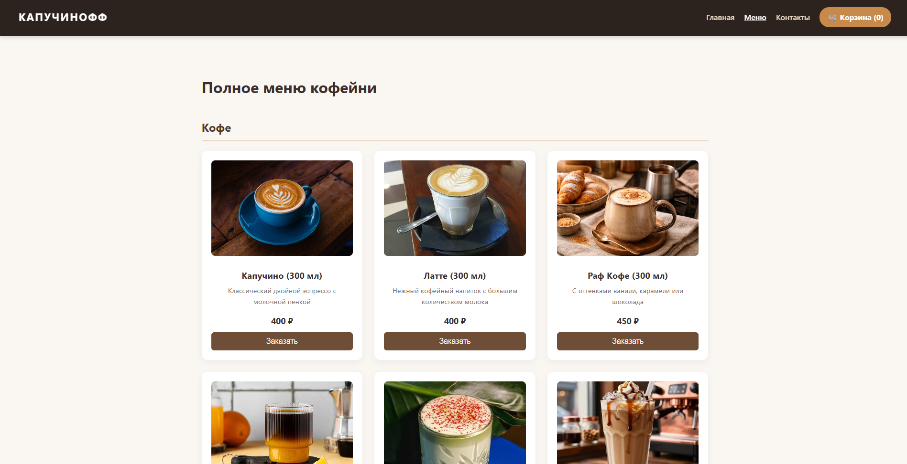

# КАПУЧИНОФФ

Кофейня «Капучинофф» работает в Ижевске - здесь можно посидеть в зале, заранее забронировать столик или заказать напитки с доставкой на дом. Сюда заходят за нормальной спокойной атмосферой, свежим кофе и чтобы не тратить кучу времени на оформление заказа. Если бронировать столик через сайт, нужно ввести своё имя, телефон (11 цифр), выбрать день на ближайшие две недели и удобное время, пока открыта кофейня - с 10:00 до 22:30.

## Что есть

- **Главная:** Стартовая страница сайта с баннером, описанием кофейни, хитами из меню и контактами.
- **Меню с категориями** (Кофе, Чай и напитки, Кухня и десерты) - тут лежат карточки товаров с фото и ценами, все позиции подгружаются из БД Microsoft Access.
- **Бронирование столика:** всплывающее окно с проверкой ввода - имя только буквами, номер на 11 цифр, нельзя выбрать время, которое сегодня уже прошло, и записаться можно не больше чем на 14 дней вперёд. Заявки сохраняются в таблицу Bookings в Access.
- **Корзина и оформление доставки:** можно закидывать позиции в корзину без обновления страницы, удалять лишнее и сразу видеть итоговую сумму, а при оформлении ввести адрес и выбрать способ оплаты (картой или наличными курьеру).
- **Контакты:** • информация, как нас найти в Ижевске, режим работы и контактный телефон.

## Как это выглядит

**Главная страница:**

Основной вид главной страницы: шапка, текст о кофейне, хиты меню и наши контакты.

**Страница меню с категориями:**

Полное меню, поделённое на категории. Все позиции, цены и описания берутся прямо из Access, так что любые правки в базе сразу появляются на странице.

**Окно бронирования столика:**

Форма записи с защитой от некорректного ввода и автоматическим отключением прошедшего времени на сегодняшний день.

**Корзина и оформление доставки:**

Форма для брони столика с проверкой полей - прошедшее время на сегодняшний день само отключается.

Там лежат меню, заказы на доставку и все брони столиков.

## Как запустить

1. Скачать архив с проектом или склонировать репозиторий к себе на комп.
2. Проверить, что в главной папке вместе с кодом лежит файл базы coffee_db.accdb.
3. Поставить нужные библиотеки для Python:
pip install flask pyodbc
4. Запустить сам файл проекта:
python main.py
5. Зайти в браузер и открыть http://localhost:8080 (или http://127.0.0.1:8080).

### Структура базы данных

