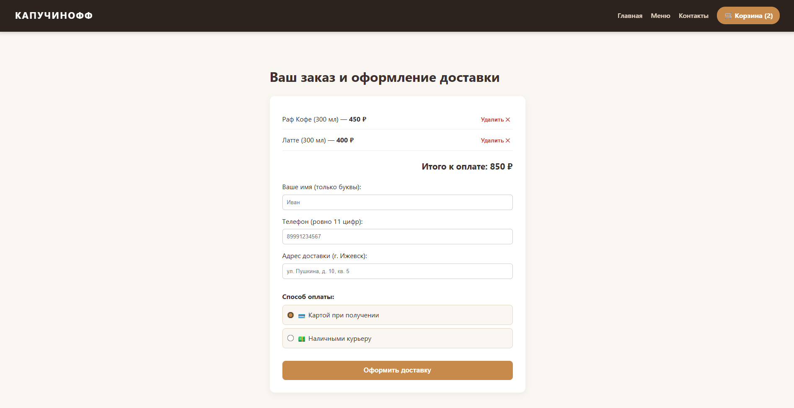

# КАПУЧИНОФФ

Кофейня «Капучинофф» оказывает услуги по обслуживанию гостей в зале, предварительному бронированию столиков и доставке напитков, выпечки и блюд домашней кухни на дом по г. Ижевску. Клиенты обращаются в кофейню за уютной атмосферой, свежим кофе и быстрым оформлением заказа. При бронировании столика через сайт гость указывает имя, номер телефона (11 цифр), дату визита (в пределах 14 дней вперёд) и удобное время в рабочие часы заведения (с 10:00 до 22:30).

## Что есть

- **Главная:** первый экран с кнопками быстрого перехода к меню и бронированию, раздел «О нас», блок «Хиты нашей кофейни» (подгружается из базы данных) и контактная информация.
- **Меню с категориями** (Кофе, Чай и напитки, Кухня и десерты): карточки с фотографиями, описанием и ценами. Все позиции автоматически загружаются из БД Microsoft Access.
- **Бронирование столика:** модальное окно, в котором реализована строгая проверка вводимых данных (имя только буквами, телефон ровно 11 цифр, блокировка прошедших часов на текущую дату и ограничение бронирования на 14 дней вперёд). Заявки сохраняются в таблицу Bookings в Access.
- **Корзина и оформление доставки:** плавное добавление позиций в корзину без перезагрузки страницы, подсчёт итоговой суммы заказа, удаление лишних позиций, ввод адреса доставки и выбор способа оплаты (картой при получении или наличными курьеру). Заказ записывается в таблицу Orders в Access.
- **Контакты:** адрес кофейни в г. Ижевске, режим работы и контактный телефон.

## Как это выглядит

**Главная страница:**

Весь основной интерфейс для посетителя кофейни: баннер, описание заведения, популярные позиции и контакты.

**Страница меню с категориями:**

Полное меню кофейни, разбитое на разделы. Все данные (названия, описания, цены, пути к фото) читаются напрямую из БД Access — при изменении записи в базе она сразу обновляется на сайте.

**Модальное окно бронирования столика:**

Форма записи с защитой от некорректного ввода и автоматическим отключением прошедшего времени на сегодняшний день.

**Корзина и оформление доставки:**

Список выбранных позиций с подсчётом итоговой суммы, полями для контактов и адреса, а также выбором способа оплаты.

Хранение меню, входящих заказов на доставку и заявок на бронирование столиков.

## Как запустить

1. Скачать файлы проекта из репозитория (или клонировать репозиторий) в локальную папку.
2. Убедиться, что в корне проекта находится файл базы данных coffee_db.accdb.
3. Установить необходимые библиотеки Python:
   pip install flask pyodbc
4. Запустить сервер:
   python main.py
5. Открыть сайт в браузере по адресу: http://localhost:8080 или http://127.0.0.1:8080.

### Структура базы данных

